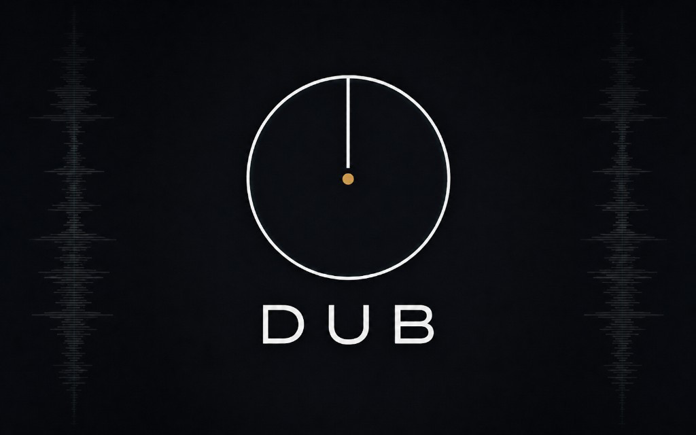
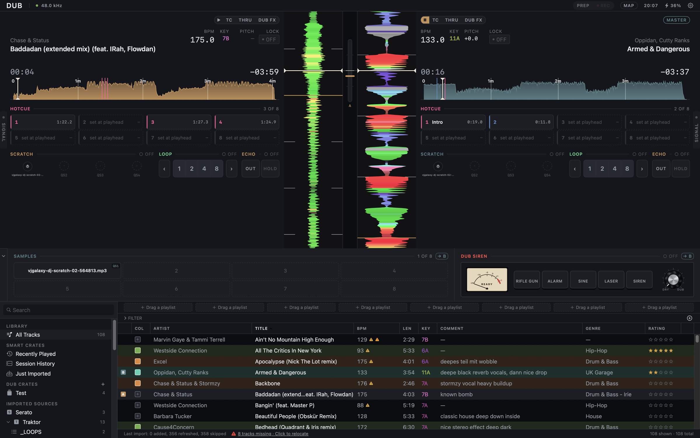
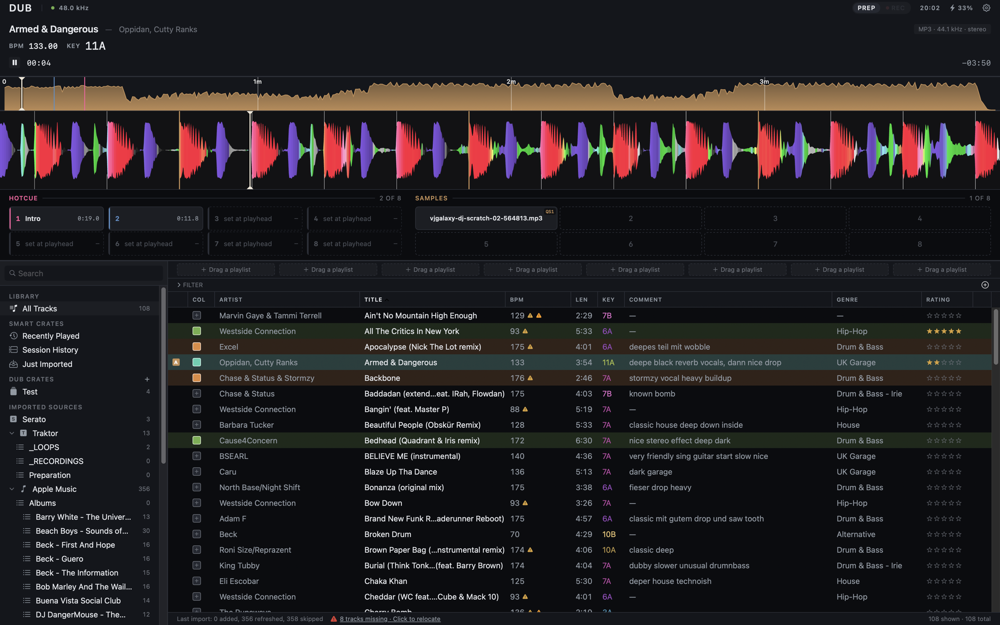
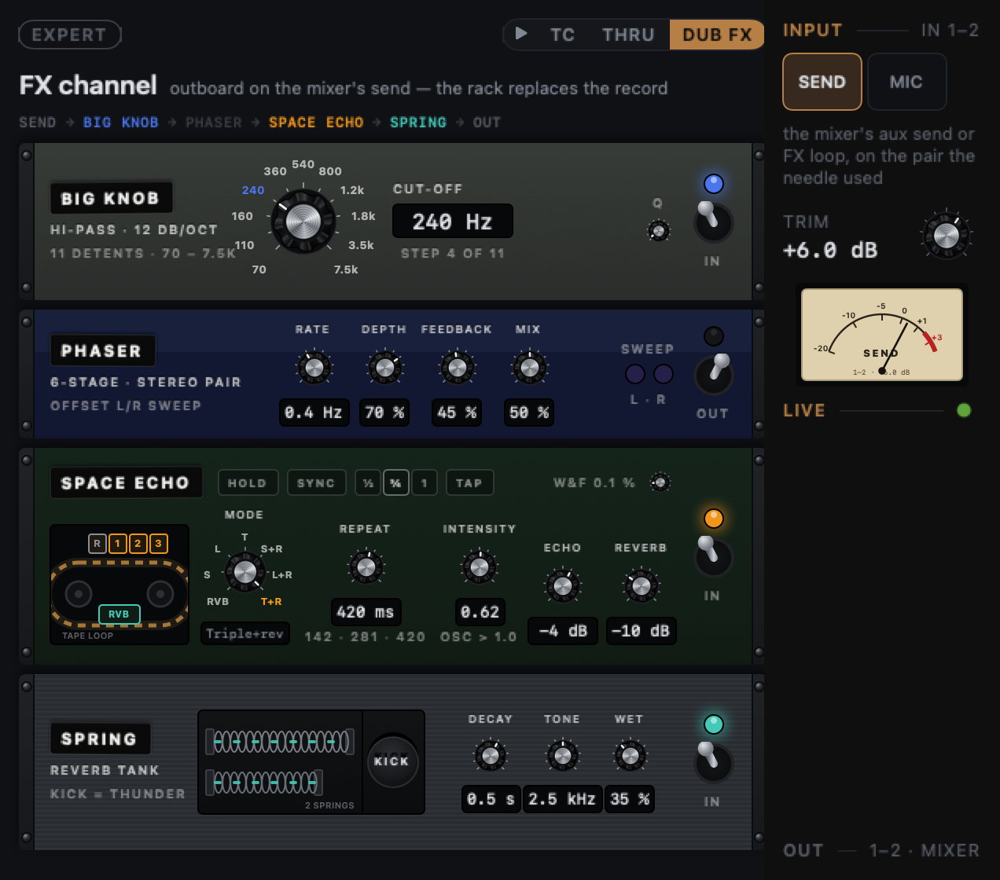
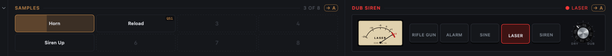
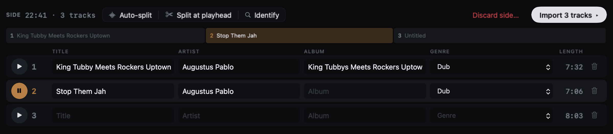

<div align="center">



# Dub

### Timecode vinyl for scratch DJs and sound systems.

Two turntables, your own mixer, real records *through* the software.<br>
Built for hip hop, reggae, dub, drum'n'bass and dubstep — and for never failing on stage.

[](https://github.com/kLOsk/dub/releases/latest)
[](https://github.com/kLOsk/dub/releases)
[](https://github.com/kLOsk/dub/actions/workflows/ci.yml)
[](#license)
[](#get-dub)
[](crates)
[](apple)
[](#under-the-hood)

[**Features**](#features) · [**Get Dub**](#get-dub) · [**Hardware**](#hardware) · [**Under the hood**](#under-the-hood) · [**Docs**](docs/README.md)

<br>



</div>

<br>

> **Alpha.** Dub plays, scratches, loops, rips and dubs on real hardware today,
> and it is still being proven on the rig one session at a time. Expect rough
> edges; don't take it to a paying gig yet. See [Status](#status).

## Why Dub

Most DJ software wants to be the whole booth. Dub wants to be the part between
your turntables and your mixer, and to be very good at it.

- **Your mixer is the mixer.** No software crossfader, EQ or gain. Each deck
  leaves on its own output pair and you mix with your hands.
- **Real records are first-class.** Flip a deck to THRU and the record on the
  platter runs through the engine — with a live waveform, a live tempo and the
  FX on it.
- **Reliability is the feature.** The audio thread never allocates, locks or
  blocks, and CI proves it on every change.
- **Yours to leave.** Import from Serato, Traktor, rekordbox and Apple Music;
  export back to rekordbox XML and M3U8. No lock-in.
- **Open source**, MIT or Apache-2.0, pure Rust underneath.

## Features

### Timecode that follows the hand

- **Serato CV02, Traktor MK1 and Traktor MK2** control vinyl, decoded by a
  clean-room decoder — relative and absolute position.
- **Scratching, needle drops, rewinds**: forward and backward playback are
  symmetric, with whole tracks held in RAM.
- **Calibrates itself** on the needle in about a second, and tells you when a
  cartridge channel or cable is failing instead of playing badly.
- **INT · TC · THRU** per deck: internal playback, timecode, or a real record
  straight through. **Panic Play** keeps the music going if the needle skips.
- **Key lock** from a pure-Rust time-stretcher.

### Waveforms you can read from across the booth

- **Metal-rendered, multi-colour waveforms** — kicks, snares and hats in
  their own colours — that stretch with the pitch fader.
- **Beat grid with set-the-1**: tap the BPM to put the downbeat where you hear
  it. Lazy analysis with BPM and **Camelot key** for every track.
- **A one-beat phase meter** between the decks, and matching scroll speeds when
  two decks are in time.



<sub>Prep mode: one deck on the built-in output, for grids, cues and samples before the gig.</sub>

### Cues, loops, scratch tools

- **8 named, coloured hot cues** per track.
- **Loops** from 1/8 to 16 beats, grid-snapped, plus manual in/out and
  reverse grab — correct under a real needle.
- **Sampler** (8 slots), **Quick Scratch** (a scratch sample on the deck in one
  press, your tune parked underneath) and **instant doubles**.
- **Map mode**: nothing ships pre-bound. Click a control, press a key, done.

### One-turntable dub



Dub's FX are modelled on the gear that made the sound, and drawn like it.

- **Echo Out + HOLD**: throw the last beat into the echo, hold it while you
  swap the record, drop the needle, let it go.
- **The DUB FX channel**: turn a deck into an outboard rack on your mixer's
  send — an Altec-style **Big Knob** high-pass, a six-stage **phaser**, an
  RE-201-style **Space Echo** with tape heads, wow & flutter and runaway, and a
  **spring tank** you can kick.
- **Space Echo SYNC + TAP**: repeats lock to the other deck's live tempo.
- Every unit keeps its real controls. No presets pretending to be gear.

*HOLD and the DUB FX channel are still being finished. They're off by
default, under **Preferences ▸ Alpha**.*

<br clear="right">

### Dub siren



Five shots — Rifle Gun, Alarm, Sine, Laser, Siren — through their own
PT2399-style echo, with one **DUB** knob from dry to drenched. It is an
instrument, not an effect: it sounds with or without a track.

### Rip your vinyl



Drop the needle and Dub records the side. It starts on the music, stops at
the run-out, **splits the tracks**, and hands you a tracklist to check.
Finish, and you have tagged, analysed **FLAC** files in your library.

- Crash-safe capture with session recovery, and re-splitting from the lossless
  archive later.
- Optional **recognition** (AcoustID, MusicBrainz, Discogs) fills in the names.
  A rip never depends on the network.

### A library that respects yours

- **Imports** Serato (crates, grids, cues), Traktor, rekordbox XML and
  Apple Music / iTunes, side by side with Dub's own analysis.
- **Crates, smart crates, ratings, colours**, filters, and "played into"
  history that remembers what you mixed out of each tune.
- **Missing-file relocation** and audio-fingerprint duplicate detection.
- **Exports** rekordbox XML and M3U8.

## Get Dub

### Download

Grab **`Dub-…-macOS-universal.zip`** from the
[latest release](https://github.com/kLOsk/dub/releases/latest). One app for
Apple Silicon and Intel Macs, **macOS 13 or later**.

1. Unzip it and drag **Dub** into **Applications**.
2. Open it. The alpha is not notarized by Apple yet, so macOS stops it the
   first time: open **System Settings → Privacy & Security**, scroll to
   *"Dub" was blocked*, and click **Open Anyway**. You only do this once.
   (Or, in Terminal: `xattr -dr com.apple.quarantine /Applications/Dub.app`.)
3. Allow microphone access when asked — that is how macOS names the audio
   interface's inputs, where the timecode and your records come in.

### Build it yourself

You need Xcode, Rust stable and [XcodeGen](https://github.com/yonaskolb/XcodeGen).

```bash
brew install xcodegen
git clone https://github.com/kLOsk/dub.git && cd dub
./scripts/bootstrap.sh                 # one-time: bindings + Xcode project
make app APP_CONFIG=Release
open apple/build/Build/Products/Release/Dub.app
```

Without an audio interface Dub opens in **Prep**: one deck on the built-in
output for grids, cues and samples. Plug in an interface with at least
**4 inputs and 4 outputs** and it becomes the two-deck **Performance** surface.

## Hardware

| Hardware | Role | Status |
|---|---|---|
| Serato SL 3 | Interface (reference rig) | ✅ tested |
| Serato Control CV02 vinyl | Timecode | ✅ tested |
| Traktor Scratch MK1 vinyl | Timecode | ✅ tested |
| Traktor Scratch MK2 vinyl | Timecode | ⚠️ decoder shipped, awaiting a real pressing |
| Native Instruments Audio 6 | Interface | ⚠️ profile unverified |
| Any external mixer with line inputs | The mixer | ✅ |
| Phase, MIDI / HID controllers | Control | ◻ planned after 1.0 |

Other class-compliant 4-in / 4-out interfaces should work; channel routing is
set in Preferences.

## Status

Dub is **alpha** — [1.0.0-alpha.1](https://github.com/kLOsk/dub/releases/tag/v1.0.0-alpha.1)
is the first public build: feature-complete for 1.0 and being signed off
against a [hardware checklist](docs/RIG-CHECKLIST.md) on real turntables.

Known gaps right now:

- Live tempo on a THRU record reads drum'n'bass at two-thirds of its tempo.
  Tap the BPM to override.
- Traktor MK2 and the Audio 6 have not been confirmed on real hardware.
- The download is not notarized yet (see [Download](#download)).
- macOS only.

What is in flight lives in [`docs/history/CURRENT.md`](docs/history/CURRENT.md);
everything shipped is in [`SHIPPED.md`](docs/history/SHIPPED.md); the product
spec is [`PRD.md`](docs/spec/PRD.md).

## Under the hood

- **Rust on the audio thread.** The engine runs in a CoreAudio IOProc with zero
  allocations, zero locks and zero syscalls — enforced by
  [`assert_no_alloc`](https://crates.io/crates/assert_no_alloc) in tests and the
  [`rt-audit`](tools/rt-audit) harness in CI.
- **Clean-room timecode.** [`dub-timecode`](crates/dub-timecode) decodes Serato
  and Traktor vinyl without borrowing anyone's code, and is tested against
  recordings of real control records.
- **Pure-Rust DSP**: tempo and beat-grid analysis, key detection, time-stretch,
  fingerprinting and FLAC encoding, with no C or copyleft dependencies.
- **SwiftUI + AppKit shell** over UniFFI bindings, with Metal waveforms drawn
  off the main thread.
- **Tested like it matters**: over 1,600 Rust tests and 280 Swift unit and
  snapshot tests, fuzzed library parsers, and gates fitted against real records.

The FFI contract version (`dub_ffi::FFI_VERSION`) is **84** at the
time of writing. Architecture notes: [`ARCHITECTURE.md`](docs/spec/ARCHITECTURE.md).

### The `dub` CLI

Everything the app does is reachable offline from one binary:

```bash
make ci                                       # build + every gate CI runs
./target/release/dub play --realtime track.mp3
./target/release/dub timecode-deck a.mp3 b.mp3 --device-profile "SL 3"
./target/release/dub scope --input-channels 3,4    # live timecode inspector (TUI)
./target/release/dub rip --help                    # rip a record side from the terminal
./target/release/dub export --help                 # rekordbox XML / M3U8
```

## Repo layout

```
dub/                                 repo root (workspace)
├── Cargo.toml                       Rust workspace
├── crates/
│   ├── dub-engine/                  audio graph, transport, RT-safety, LiftPolicy, ThruSource
│   ├── dub-audio/                   CoreAudio HAL input + output (M1.4, M5.2, M5.5.2, M5.6)
│   ├── dub-dsp/                     resamplers, filters, EchoOut + PT2399 + siren units + vintage FX chain
│   ├── dub-stretch/                 pure-Rust WSOLA time-stretch / key lock (M14; Rubber Band dropped)
│   ├── dub-io/                      symphonia-based decoders (everything in RAM)
│   ├── dub-timecode/                Serato CV02 + Traktor MK1/MK2 decoder (clean-room)
│   ├── dub-thru/                    Thru-mode source-detection classifier (§5.1.1, placeholder)
│   ├── dub-bpm/                     BPM engine + beat grid (BpmEstimator/Tracker/Stream, log-band ODF, OctaveProfile, downbeat, tap-to-grid — pure-Rust)
│   ├── dub-spectral/                M9.5a — SpectralFrameStream (shared STFT + log-bands + magnitude compression), pure-Rust
│   ├── dub-peaks/                   M9 + M9.5b — Decimator + BandDecimator, PeakBuffer (broadband + bands), PeakStream — live waveform capture
│   ├── dub-fingerprint/             Pure-Rust Chromaprint (M11b library dedupe; v1.1 recognition parked)
│   ├── dub-library/                 SQLite catalog + import adapters (M11, shipped)
│   ├── dub-encode/                  M26 — FLAC encode (flacenc) + Vorbis-comment tagging
│   ├── dub-rip/                     M26 — vinyl-rip engine: capture, gap detection, side trim, commit
│   ├── dub-recognize/               M26c — AcoustID + MusicBrainz behind an `Http` trait (the only
│   │                                network dep; rips work fully offline without it)
│   ├── dub-controller/              HID/MIDI abstractions (v1.x+, placeholder)
│   ├── dub-ffi/                     UniFFI Swift bindings — DubEngine, DubLibrary, DubRipSession
│   └── dub-cli/                     `dub` binary (smoke / play / capture / levels /
│                                                 timecode-deck / thru / scope / calibrate /
│                                                 analyze / diagnose / import / rip /
│                                                 rip-tune / rip-resplit / recognize /
│                                                 export / decode-timecode)
├── apple/                           AppKit + SwiftUI shell (Performance + Prep mode, library browser — XcodeGen-managed)
│   ├── project.yml                  XcodeGen manifest (links CoreAudio + Metal SDK frameworks)
│   ├── Dub/                         AppKit @main + SwiftUI shell
│   │   ├── Performance/             two-deck surface, library/file browser, deck header, tap-to-grid
│   │   ├── Waveform/                Metal renderer + off-main-thread render thread + playhead marker + Shaders.metal
│   │   ├── Preferences/ · About/ · DesignSystem/ · App/
│   │   └── Assets.xcassets/         App icon + About splash artwork
│   └── DubShared/                   Swift Package wrapping DubCore.xcframework
├── tools/
│   └── rt-audit/                    RT-thread allocation auditor
├── docs/                            README.md = routing guide; spec/ (PRD, PRD-BEATS, ARCHITECTURE,
│                                    LIBRARY-SCHEMA, LIBRARY-FORMATS, LICENSE-DEPENDENCIES),
│                                    history/ (CURRENT, SHIPPED, LESSONS), investigations/,
│                                    UI-BACKLOG.md
├── testdata/rip-baselines/          three real record sides (24-bit FLAC, gitignored) — ground
│                                    truth for the rip gates; replay with `dub rip-tune`
├── fuzz/                            cargo-fuzz targets for the library parsers
├── scripts/                         build-xcframework.sh, bootstrap.sh (M0.5)
├── .cursor/                         Cursor rules + hooks for AI-assisted dev
└── AGENTS.md                        always-loaded project context for AI
```

## Engineering tenets

These are anchored in [`docs/spec/PRD.md` §2.2](docs/spec/PRD.md) and enforced both
socially and in CI:

1. **No allocations on the audio thread.** Static buffers, lock-free SPSC
   ringbufs, `assert_no_alloc` in tests + a dedicated rt-audit binary.
2. **TDD on anything that touches a real audience.** Pre-alpha is permitted to
   move fast (PRD §2.2.0), but stable releases must demonstrate full coverage
   on every audio-path code path.
3. **The engine matches the device, never the other way around.** v1 does no
   boundary resampling; both input and output devices are forced to the engine's
   sample rate, or startup fails loudly. (See M5.3 SR-alignment notes in
   ARCHITECTURE.md.)
4. **DJs stand in front of audiences.** Stuttering, dropouts, sample-rate
   converter artifacts, and policy chatter are no-go bugs, not "polish later"
   bugs. The `dub analyze` and `dub scope` tools exist so we can verify
   correctness without subjective listening sessions.

## Common commands

```bash
make test          # cargo nextest run + clippy
make smoke         # run the CLI smoke test
make rt-audit      # run the RT-safety harness
make ci            # everything CI runs (docs-check + fmt-check + clippy + test)
make docs-check    # FFI / schema / crate-count numbers in the docs match the code
make sweep         # drop build artifacts unused for 14 days (keeps the suite fast)
make clippy        # cargo clippy --workspace --all-targets -- -D warnings
make fmt           # cargo fmt
make app           # build Dub.app (Debug) — also regenerates xcodeproj if project.yml changed
make run-app       # build + launch Dub.app from apple/build/
```

See the [Makefile](Makefile) for more targets.

## License

**MIT OR Apache-2.0**, at your option — see [`LICENSE-MIT`](LICENSE-MIT) and
[`LICENSE-APACHE`](LICENSE-APACHE).

This means: do what you like with it, keep the copyright notice. Apache-2.0
additionally carries an explicit patent grant, which is why both are offered —
it is the Rust ecosystem's convention and what most of Dub's dependency graph
already uses.

*Relicensed from GPL-3.0-or-later.* The GPL was only ever a reservation for a
planned `rubberband` (GPL-3.0) time-stretch dependency; M14 shipped a pure-Rust
WSOLA instead, so it never landed and nothing in the graph ever forced the
licence. Going permissive keeps open what GPL forecloses — a proprietary
controller SDK, a Mac App Store build, a commercial tier — and the choice was
made while the project is still single-author, because relicensing later needs
every contributor's agreement. Full reasoning in
[`LICENSE-DEPENDENCIES.md`](docs/spec/LICENSE-DEPENDENCIES.md).

## Contributing

This is currently a single-developer project. Contributions are welcome but
expect reviews to be opinionated about reliability and the No-Mouse-DJ-Ever
philosophy. Read [`docs/spec/PRD.md`](docs/spec/PRD.md) first; for engineering background,
[`docs/spec/ARCHITECTURE.md`](docs/spec/ARCHITECTURE.md).

Bugs and feature requests: open an issue. Patches: open a PR against `main`.
CI must be green; new audio-path code requires `assert_no_alloc` coverage and
ideally a `rt-audit` extension.
